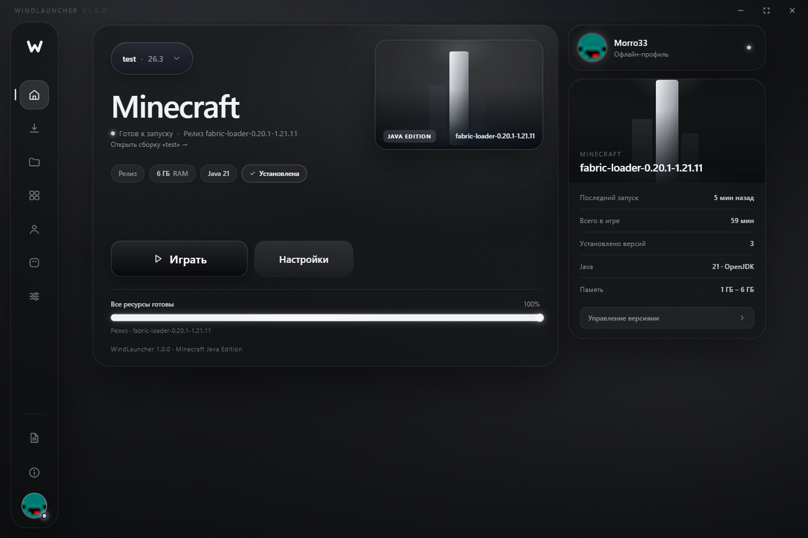

# WindLauncher

Лаунчер Minecraft Java Edition: сборки, моды, ресурспаки, шейдеры и воксельная 3D-косметика в одном окне.

## Что внутри

- Сборки: свой контент, версия, загрузчик, папки в файлах.
- Каталог Modrinth и CurseForge с фильтрами по версии и загрузчику.
- Шейдеры и ресурспаки в один клик.
- 3D-косметика: шапки и крылья с анимацией, видна только владельцу.
- Portable-сборка: один exe, без установщика.

## Скачать

Windows 10/11 x64, ~95 МБ:

https://github.com/Morro33/windlauncher-site/releases/latest/download/WindLauncher.exe

SHA-256: `4c6a83beb1410c29a36ae87af9feaf659278440f3650a5bde3d29b9eb0658872`

## Стек

Electron + React + TypeScript, Vite. Сайт — статический HTML/CSS/JS, публикуется через GitHub Pages.
